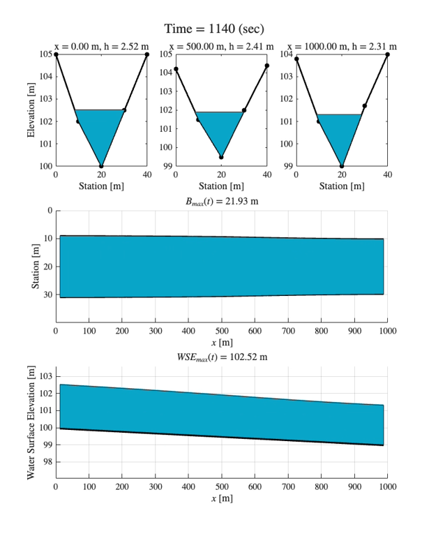
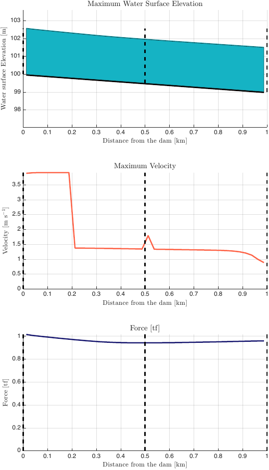

# 🌊 HydroHP-1D: Unsteady Saint-Venant Solver for Rivers and Dam Breaks

**HydroHP-1D** is an open MATLAB solver of the unsteady Saint-Venant equations
for one-dimensional open-channel flow. It runs on surveyed cross-sections that
vary along the reach, with a finite-volume scheme that keeps depths
nonnegative on dry beds and at dam-break fronts.

[](./LICENSE)

[](https://doi.org/10.1016/j.envsoft.2023.105733)


---

## 📌 Overview

HydroHP has two run paths.

| Path | Entry point | Geometry | Scheme |
|---|---|---|---|
| Varying-geometry kernel | `hydrohp_run_varying` | Surveyed cross-sections that vary along the reach | Finite volume, HLL fluxes, hydrostatic reconstruction |
| Legacy V5 | `hydrohp_run`, `HydroHP_1D_V5.m` | Regular sections, or one irregular section for the whole reach | Explicit Lax-Friedrichs |

The V5 path is the model published in Gomes Júnior et al. (2023). The
varying-geometry kernel extends it for cross-sections that vary along the
reach. Commit `27c25ec` is the kernel version used as the one-dimensional
baseline of a dam-break mapping study that is under review.

---

## 🧭 Workflow

```text
Surveyed cross-sections (CSV, MATLAB table, or Excel sheet)
        │
        ├── hydrohp_build_section_tables
        │       └── one hydraulic table per section (area, width, conveyance)
        │
        ├── hydrohp_run_varying
        │       ├── tables mapped to every cell centre and face
        │       ├── HLL fluxes with hydrostatic reconstruction
        │       ├── inflow and outlet that follow the local flow regime
        │       └── mass ledger and applicability guard
        │
        └── result
                ├── maxima of stage, depth, and velocity per cell
                ├── stored history and per-step probes
                └── hydrohp_postprocess_varying
                        └── V5 figures, videos, and CSV tables
```

---

## ✨ What the Varying-Geometry Kernel Adds

- Each surveyed cross-section gets its own hydraulic table. Area, wetted
  perimeter, top width, hydrostatic integral, and conveyance are tabulated by
  depth.
- The tables are mapped to every cell centre and cell face. Between two
  surveyed sections, each property is interpolated at the same fraction of the
  two sections' depth ranges. The bed is interpolated linearly.
- Each section is closed at the lower of its two bank tops. HydroHP never adds
  vertical walls. A flow that rises above a section top is reported, not
  extended.
- Every run keeps a mass ledger (inflow, outflow, storage, residual).

---

## 📐 Equations

Along chainage $x$, with no lateral inflow,

$$
\frac{\partial A}{\partial t}+\frac{\partial Q}{\partial x}=0,
$$

$$
\frac{\partial Q}{\partial t}
+\frac{\partial}{\partial x}\left(\frac{Q^2}{A}\right)
+gA\frac{\partial \eta}{\partial x}=-gAS_f,
\qquad
S_f=\frac{Q|Q|}{K^2},
$$

where $A$ is wetted area, $Q$ is discharge, $\eta$ is water-surface elevation,
$g$ is gravity, $S_f$ is friction slope, and $K$ is the section conveyance from
its table. For one channel with Manning coefficient $n$ and hydraulic radius
$R$, $K = AR^{2/3}/n$, so $S_f = n^2Q|Q|/(A^2R^{4/3})$.

---

## 🧮 Numerics

- Finite-volume scheme on a uniform grid with HLL fluxes (Harten et al., 1983)
  at every face. Friction is applied semi-implicitly after the flux update.
- Hydrostatic reconstruction (Audusse et al., 2004) is the runner default. At
  each interior face the bed is the higher of the two neighbouring cell
  inverts, and each side's depth is `max(0, eta - face bed)`. The
  reconstructed depth never exceeds the cell depth, so depths stay nonnegative
  on dry beds and at wet and dry fronts. Equal water levels give equal face
  states, so a lake at rest stays at rest.
- Stage reconstruction (`reconstruction = "stage"`) is kept only for the tests
  that require the compiled kernel to match the reference kernel exactly.
- The time step follows a CFL target (default 0.7) between `minimum_dt_s` and
  `maximum_dt_s`. A step that violates the CFL condition is halved and
  repeated.
- Two kernels give identical results for the same options. `"compiled"`
  (default) is vectorized and is required for hydrostatic reconstruction and
  regime boundaries. `"reference"` is the scalar version kept for the
  equivalence tests.

---

## 🚧 Boundary Conditions

With `boundary_formulation = "regime"` (default), both boundaries follow the
local flow regime.

**Inlet.** The discharge hydrograph enters as follows.

| Inlet state | Rule |
|---|---|
| Normal-depth state of the inflow is supercritical | Impose the discharge and its normal-depth area |
| Subcritical | Impose the discharge. Take the area from the outgoing characteristic |
| No outgoing characteristic (dry inlet cell, or supercritical cell under subcritical normal flow), or no subcritical state admits the inflow | Impose the discharge at normal depth if the inlet cell is dry, at critical depth otherwise |
| Zero discharge | Reflective wall |

**Outlet.**

| Outlet state | Rule |
|---|---|
| Supercritical, dry, or nearly dry | Free outflow |
| Subcritical | Normal-depth rating at `downstream.slope`, or a fixed `downstream.stage_m` |
| Subcritical cell but no subcritical normal-depth state (steep outlet) | Critical-depth control |
| Supercritical flow back into the reach | Reflected, so the outlet never imports water |

The outlet rating uses one constant energy slope for the whole run. HydroHP
does not compute it. The caller supplies it as `downstream.slope`.

`boundary_formulation = "legacy"` keeps the earlier inlet, which extrapolates
the local depth and falls back to critical depth.

---

## 💧 Initial State

| `initialization_type` | Start |
|---|---|
| `"normal_depth"` (default) | Normal depth of `base_discharge_m3s` on the local bed slope. Pools and very flat cells use the reach-average slope. Add a spin-up with `spinup_duration_s` |
| `"dry"` | Zero area and zero discharge. The hydrograph alone wets the reach. No spin-up is needed |
| `"stage"` | A given water level, one value or one per cell |

The dam-break study used the dry start.

---

## 🛑 Applicability Guard

When water rises above the top of a section, the run cannot continue on that
geometry. With the default `overtopping_action = "error"`, HydroHP raises an
error. With `"stop"`, the run ends at the last accepted state,
`result.status` is `"overtopped"`, and `result.overtopping` records the time
and chainage. This is a limit of the section geometry, not a solver failure.

---

## 🚀 Quick Start

Run from the repository root. This example uses the three sections in
`Examples/cross_sections_example.csv` and starts dry.

```matlab
addpath(pwd)
section_data = hydrohp_build_section_tables( ...
    "Examples/cross_sections_example.csv", 0.02, "scm");

input = struct( ...
    'section_data', section_data, ...
    'face_x_m', linspace(0, 1000, 41).', ...   % 40 cells of 25 m
    'hydrograph_time_s', [0; 600; 1800; 3600; 7200], ...
    'hydrograph_discharge_m3s', [0; 40; 15; 0; 0], ...
    'duration_s', 7200, ...
    'downstream', struct('type', "normal_depth", 'slope', 1e-3), ...
    'initialization_type', "dry", ...
    'output_interval_s', 60);
result = hydrohp_run_varying(input);

result.status                    % "completed" or "overtopped"
result.maxima.stage_m            % maximum water level per cell (m)
result.maxima.velocity_m_s       % maximum mean velocity per cell (m/s)
result.ledger.relative_residual  % volume balance

files = hydrohp_postprocess_varying(result, input);   % figures, videos, CSVs
```

`Examples/run_varying_example.m` runs this case and writes every
post-processing product to `Modeling_Results/`.

---

## 📊 Outputs

`hydrohp_postprocess_varying` writes the V5 post-processing products for a
varying-section run, with the same file names, layouts, and formatting.

| Product | Contents |
|---|---|
| `Surf_Plots.pdf` | Froude number, depth, and water level over distance and time |
| `Summary_Charts.pdf` | Discharge, velocity, depth, Froude number, and top width at up to five points, plus the inlet rating curve |
| `Maximum_WSE_Velocity_Depth.pdf` | Maximum water level, velocity, and force on a person along the reach |
| `Dam_Breach_Like_.mp4`, `Model_Results.mp4`, `Depth_WSE_Top_Width.mp4` | Animations along the reach and at three surveyed sections |
| `Detailed_Output.csv`, `Detailed_Output_XS.csv` | Depth, discharge, velocity, Froude number, top width, and water level per cell and time |
| `Dam_Breach_Like_Outputs.csv` | Arrival time, maximum depth, velocity, and force at each point |

<p align="center">
  
  
</p>
<p align="center"><em>Example outputs from <code>Examples/run_varying_example.m</code>. Left, one frame of the cross-section video. Right, maximum water level, velocity, and force along the reach.</em></p>

---

## 🔗 Documentation and Resources

| Resource | Link |
|---|---|
| User manual | [docs/user_manual.md](docs/user_manual.md) |
| Inputs, options, and outputs | [docs/inputs_outputs.md](docs/inputs_outputs.md) |
| Cross-section table rules | [docs/cross_section_input.md](docs/cross_section_input.md) |
| Model paper | <https://doi.org/10.1016/j.envsoft.2023.105733> |
| Supplementary material (V5 workbook) | [docs/reference/Supplementary_Material_HydroHP.pdf](docs/reference/Supplementary_Material_HydroHP.pdf) |

---

## 🗂️ Legacy V5 Path

Run a workbook without editing the solver:

```matlab
input = hydrohp_read_excel("Examples/Example_2_Dam_Break.xlsx");
result = hydrohp_run(input);
```

The returned structure contains time, distance, area, discharge, depth,
velocity, Froude, Courant, and execution-time arrays. Set
`input.postprocess = true` to request the legacy figures and CSV outputs.
`Examples/run_from_script.m` also shows optional script-defined hydrograph and
Manning values. The original `HydroHP_1D_V5.m` entry point remains available.

The example workbooks cover regular channel design, a regular-section dam
break, and a single irregular section. The V5 path supports discharge or stage
hydrographs, trapezoidal, circular, parabolic, and irregular sections, single
and divided-channel hydraulic properties, and automatic plots, videos, and CSV
outputs.

---

## ⚙️ Requirements

- MATLAB. The frozen V5 baseline was run with R2023b. The test suite passes
  with R2025b.
- No toolbox is needed for the varying-geometry kernel.
- Excel-compatible `.xlsx` files for the V5 inputs.

---

## 🧪 Tests

Each file in `tests/` is a function that stops with an error when a check
fails. Run all of them from the repository root:

```bash
matlab -batch "addpath(pwd); addpath('tests'); files = dir('tests/test_*.m'); for k = 1:numel(files), [~, name] = fileparts(files(k).name); disp(name); feval(name); end"
```

<details>
<summary>What each of the 16 tests checks</summary>

| Test | Checks |
|---|---|
| `test_cross_section_input` | Section table from MATLAB, CSV, and Excel, ordering, and input errors |
| `test_section_hydraulics` | Section tables against analytic geometry |
| `test_section_grid_mapping` | Bracketing and interpolation of tables between sections |
| `test_varying_geometry_kernel` | Lake at rest, CFL control, wet and dry fronts, volume |
| `test_compiled_kernel_equivalence` | Compiled and reference kernels give identical steps |
| `test_hydrostatic_reconstruction` | Positivity and balance of hydrostatic reconstruction |
| `test_negative_area_capture` | Capture of the first negative raw area on a steep reach |
| `test_varying_run` | Runner boundaries, initialization, and mass ledger |
| `test_boundary_regimes` | Regime-based inflow and outlet rules |
| `test_pool_initialization` | Normal-depth start on a bed with pools |
| `test_dry_start` | Dry start, exact inflow volume, volume balance |
| `test_event_outputs` | Sparse history, online maxima, and probes |
| `test_overtopping_guard` | Stop and report when water leaves a section |
| `test_postprocess_varying` | Every post-processing file, CSV values, probe and history sources |
| `test_h7_regression_package` | Published normal flow and analytical dam break |
| `test_hydrohp_interface` | Legacy V5 interface from Excel and from a structure |

</details>

---

## 📁 Repository Organization

```text
HydroHP/
├── hydrohp_run_varying.m             varying-geometry runner
├── hydrohp_varying_step_compiled.m   compiled finite-volume step
├── hydrohp_varying_step.m            scalar reference step
├── hydrohp_build_section_tables.m    hydraulic table per section
├── hydrohp_map_sections_to_grid.m    tables at cells and faces
├── hydrohp_postprocess_varying.m     V5 figures, videos, and CSVs
├── hydrohp_*.m                       section input, validation, and helpers
├── hydrohp_run.m                     callable V5 interface
├── HydroHP_1D_V5.m                   legacy V5 solver and its scripts
├── Examples/                         example inputs for both paths
├── tests/                            test functions
├── docs/
│   ├── user_manual.md                step-by-step guide
│   ├── inputs_outputs.md             every input, option, and output
│   ├── cross_section_input.md        cross-section table rules
│   ├── figures/                      manual figures
│   ├── reference/                    published supplement and figures
│   └── tutorial/                     slides and teaching material
├── apps/                             optional MATLAB applications
├── CITATION.cff
└── LICENSE
```

Generated results and historical ZIP distributions are not kept on the active
branch. They remain recoverable from Git history and the tag
`legacy-v5-pre-modernization-2026-10-07`.

---

## 📄 Citation

Please cite the model paper:

> Gomes Júnior, M. N., Castillo Rápalo, L. M. C., Oliveira, P. T. S.,
> Giacomoni, M. H., do Lago, C. A. F., and Mendiondo, E. M. (2023).
> Modeling unsteady and steady 1D hydrodynamics under different hydraulic
> conceptualizations: Model/software development and case studies.
> *Environmental Modelling & Software*, 167, 105733.
> https://doi.org/10.1016/j.envsoft.2023.105733

If you use the varying-geometry kernel, also give the commit you ran. The
dam-break study used commit `27c25ec`. Machine-readable citation metadata are
in `CITATION.cff`.

### BibTeX

```bibtex
@article{gomes_hydrohp_2023,
  author  = {Gomes J{\'u}nior, Marcus N. and Castillo R{\'a}palo, Luis M. C. and
             Oliveira, Paulo T. S. and Giacomoni, Marcio H. and
             do Lago, C{\'e}sar A. F. and Mendiondo, Eduardo M.},
  title   = {Modeling unsteady and steady 1D hydrodynamics under different
             hydraulic conceptualizations: Model/software development and
             case studies},
  journal = {Environmental Modelling \& Software},
  volume  = {167},
  pages   = {105733},
  year    = {2023},
  doi     = {10.1016/j.envsoft.2023.105733}
}
```

```bibtex
@misc{gomes_hydrohp_github_2026,
  author    = {Gomes Jr., Marcus N.},
  title     = {HydroHP-1D: Unsteady Saint-Venant Solver with Cross-Sections
               that Vary Along the Reach},
  year      = {2026},
  publisher = {GitHub},
  url       = {https://github.com/marcusnobrega-eng/HydroHP}
}
```

### Numerical methods

- Harten, A., Lax, P. D., and van Leer, B. (1983). On upstream differencing
  and Godunov-type schemes for hyperbolic conservation laws. *SIAM Review*,
  25(1), 35-61. https://doi.org/10.1137/1025002
- Audusse, E., Bouchut, F., Bristeau, M.-O., Klein, R., and Perthame, B.
  (2004). A fast and stable well-balanced scheme with hydrostatic
  reconstruction for shallow water flows. *SIAM Journal on Scientific
  Computing*, 25(6), 2050-2065. https://doi.org/10.1137/S1064827503431090

---

## ⚠️ Known Limitations

- The varying-geometry runner needs a uniform grid that lies between the first
  and last section chainages.
- There is no lateral inflow.
- Velocity is the mean over each cross-section. Near a dry front its maximum
  can come from water only a few centimetres deep.
- Hydrostatic reconstruction overestimates depth where the bed drop across a
  face exceeds the water depth (Delestre et al., 2012). The kernel counts
  those faces in its step diagnostics.
- The bed between sections is interpolated linearly, so it can differ from the
  true bed on long section spacings.
- The V5 kernel remains a monolithic script and still reads its base
  configuration and geometry from an Excel workbook. Some legacy
  postprocessing profiles fail after the numerical loop completes.

---

## 👤 Developer

**Marcus N. Gomes Jr., PhD**  
Postdoctoral Researcher, Stanford University  

GitHub: [@marcusnobrega-eng](https://github.com/marcusnobrega-eng)  
ORCID: [0000-0002-8250-8195](https://orcid.org/0000-0002-8250-8195)  
Email: `marcusnobrega.engcivil@gmail.com`

---

## 📜 License

HydroHP is released under the MIT License. See [`LICENSE`](./LICENSE) for
details.
