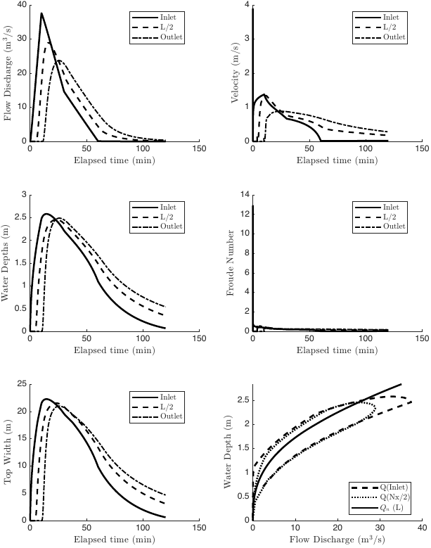

# HydroHP user manual

This manual walks through a run of the varying-geometry kernel
(`hydrohp_run_varying`), from surveyed cross-sections to checked results. The
legacy V5 path has a short section near the end. Every input, option, and
output is listed in [inputs_outputs.md](inputs_outputs.md). The cross-section
table rules are in [cross_section_input.md](cross_section_input.md).

## Contents

1. [Install](#1-install)
2. [Workflow](#2-workflow)
3. [Prepare cross-sections](#3-prepare-cross-sections)
4. [Build and check the section tables](#4-build-and-check-the-section-tables)
5. [Choose the grid](#5-choose-the-grid)
6. [Set the hydrograph](#6-set-the-hydrograph)
7. [Set the boundaries](#7-set-the-boundaries)
8. [Set the initial state](#8-set-the-initial-state)
9. [Run](#9-run)
10. [Read the results](#10-read-the-results)
11. [Check the run](#11-check-the-run)
12. [Worked example](#12-worked-example)
13. [Troubleshooting](#13-troubleshooting)
14. [Legacy V5 path](#14-legacy-v5-path)
15. [Cite](#15-cite)

## 1. Install

HydroHP needs MATLAB only. The varying-geometry kernel uses no toolbox. The
tests pass with R2025b.

```bash
git clone https://github.com/marcusnobrega-eng/HydroHP.git
cd HydroHP
```

The kernel is on `main`. For reproducible work, check out the exact commit you
will cite. The dam-break study used `27c25ec`.

Add the repository root to the MATLAB path and run one short test:

```matlab
addpath(pwd)
addpath(fullfile(pwd, 'tests'))
test_dry_start
```

It prints `HydroHP dry-start checks passed` in a few seconds. The README lists
the command that runs the whole suite.

## 2. Workflow

| Step | Function or field | Section |
|---|---|---|
| Prepare cross-sections | CSV, MATLAB table, or Excel sheet | [3](#3-prepare-cross-sections) |
| Build one hydraulic table per section | `hydrohp_build_section_tables` | [4](#4-build-and-check-the-section-tables) |
| Choose the grid | `face_x_m` | [5](#5-choose-the-grid) |
| Set the inflow | `hydrograph_time_s`, `hydrograph_discharge_m3s` | [6](#6-set-the-hydrograph) |
| Set the outlet | `downstream` | [7](#7-set-the-boundaries) |
| Set the start | `initialization_type` | [8](#8-set-the-initial-state) |
| Run | `hydrohp_run_varying` | [9](#9-run) |
| Read and check | `result` | [10](#10-read-the-results), [11](#11-check-the-run) |
| Write figures, videos, and CSV files | `hydrohp_postprocess_varying` | [10](#post-processing) |

## 3. Prepare cross-sections

Each section is a transverse ground profile at one chainage. Write all
sections in one long table, one row per point.

```text
section_id,chainage_m,offset_m,elevation_m,manning_n
XS001,0,0,105.0,0.060
XS001,0,10,102.0,0.040
XS001,0,20,100.0,0.035
XS001,0,30,102.5,0.045
XS001,0,40,105.0,0.060
XS002,500,0,104.2,0.060
...
```

These rules matter for the run.

- Chainage increases downstream. The inflow enters at the smallest chainage.
- The first and last points of a section (by offset) are its bank tops. The
  section table stops at the lower of the two. Water above that level has left
  the section.
- HydroHP never adds vertical walls. If a flood will rise above a bank top,
  extend the profile into higher ground. Do not raise the end points
  artificially.
- `manning_n` belongs to the segment that starts at that point. The value on
  the last point is not used.
- Place sections where the valley changes width, slope, or roughness. Between
  two sections, HydroHP interpolates the tables and the bed linearly. A long
  spacing over an irregular bed can misplace the bed by metres.
- All elevations must use one vertical datum.

HydroHP takes the sections as given. It does not decide where they go or how
wide they are. The section rule used in the dam-break study lives in that
study's repository (`scripts/preflight_hydrohp_sections_v4.py`).

## 4. Build and check the section tables

```matlab
[section_data, report] = hydrohp_build_section_tables( ...
    "Examples/cross_sections_example.csv", 0.02, "scm");
```

The second argument is the largest depth increment of each table, in metres.
Surveyed vertex elevations are always added, so the table follows breaks in
the profile. The dam-break study used 0.02 m. The third argument chooses the
conveyance method.

| Method | Conveyance |
|---|---|
| `"scm"` | One channel with an equivalent Manning coefficient |
| `"dcm"` | Sum over contiguous roughness zones (main channel and floodplains) |

The reader stops with one combined message when the table is invalid. It
reorders rows by chainage and offset and warns when it had to.

Check each section before running. A section that is too shallow for the
flood stops the run later.

```matlab
summary = table(string({section_data.section_id}).', ...
    [section_data.chainage_m].', [section_data.invert_elevation_m].', ...
    [section_data.maximum_water_surface_elevation_m].', ...
    arrayfun(@(s) s.table.area_m2(end), section_data), ...
    'VariableNames', {'id', 'chainage_m', 'invert_m', 'top_m', 'max_area_m2'})
```

`top_m - invert_m` is the deepest water each section holds.

## 5. Choose the grid

`face_x_m` lists the cell faces. The runner needs a uniform spacing, at least
two cells, and faces inside the surveyed chainage range.

```matlab
dx_m = 25;
face_x_m = (section_data(1).chainage_m:dx_m:section_data(end).chainage_m).';
```

Pick `dx_m` so the reach length is a whole number of cells. A finer grid
resolves fronts better but takes more steps, since the time step scales with
`dx_m`. The dam-break study used cells of about 30 m. To check grid
sensitivity, halve `dx_m` and compare the maxima.

## 6. Set the hydrograph

```matlab
hydrograph_time_s = [0; 600; 1800; 3600; 7200];
hydrograph_discharge_m3s = [0; 40; 15; 0; 0];
duration_s = 7200;
```

- Times start at 0, increase strictly, and reach `duration_s`.
- Discharges are nonnegative.
- HydroHP interpolates linearly and never steps across a breakpoint, so the
  inflow volume matches the hydrograph exactly.
- A longer hydrograph is cut at `duration_s`.

## 7. Set the boundaries

The default `boundary_formulation = "regime"` lets the inlet and the outlet
follow the local flow regime. The README tables give every case. In short,
supercritical inflow imposes discharge and normal depth, subcritical inflow
imposes discharge only, and inflow that no subcritical state can carry enters
at critical depth. At the outlet, supercritical or dry flow leaves freely,
subcritical flow follows the rating, and flow back into the reach is
reflected.

Choose the outlet rating:

```matlab
downstream = struct('type', "normal_depth", 'slope', 1e-3);   % rating
downstream = struct('type', "stage", 'stage_m', 101.2);        % fixed level
```

The normal-depth rating uses one constant energy slope for the whole run.
HydroHP does not estimate it. Use the bed slope near the outlet, or a slope
from your own method. The dam-break study used the energy slope of a
simplified dam-break procedure.

## 8. Set the initial state

| `initialization_type` | Use it when |
|---|---|
| `"dry"` | The reach is dry before the event, as in a dam break on a dry valley. No spin-up is needed |
| `"normal_depth"` (default) | A base flow runs before the event. Set `base_discharge_m3s` and usually a spin-up |
| `"stage"` | You know the starting water level. Give `initial_stage_m`, one value or one per cell |

The normal-depth start computes the normal depth of `base_discharge_m3s` on
the local bed slope of each cell. Pools and very flat cells use the
reach-average slope instead. That start is only a first guess, so add a
spin-up at the base discharge:

```matlab
input.base_discharge_m3s = 5;
input.spinup_duration_s = 3600;
input.steady_initialization = "require";   % or "report"
```

With `"require"`, the run stops if the spin-up has not settled. With
`"report"`, it records the change rate in `result.initialization` and runs the
event anyway. The normal-depth start needs a `"normal_depth"` outlet.

## 9. Run

```matlab
input = struct( ...
    'section_data', section_data, ...
    'face_x_m', face_x_m, ...
    'hydrograph_time_s', hydrograph_time_s, ...
    'hydrograph_discharge_m3s', hydrograph_discharge_m3s, ...
    'duration_s', duration_s, ...
    'downstream', downstream, ...
    'initialization_type', "dry", ...
    'output_interval_s', 60);
result = hydrohp_run_varying(input);
```

These options are worth setting.

| Field | Why |
|---|---|
| `output_interval_s` | The default `0` stores every step. Long events need an interval, or the history fills memory. Maxima are tracked at every step either way |
| `maximum_dt_s` | Default 1 s. Raise it for long events. The CFL target still limits each step |
| `probe_x_m` | Chainages where every step is stored, for gauges or the outlet |
| `overtopping_action` | `"stop"` ends the run cleanly when water leaves a section and reports where |
| `progress_file` | A tab-separated log of model time, step, storage, and volumes |
| `checkpoint_file` | A `.mat` file with the latest state, for monitoring long runs |

The checkpoint is for monitoring. The runner has no restart option.

Keep the defaults for `reconstruction` (`"hydrostatic"`), `kernel`
(`"compiled"`), and `boundary_formulation` (`"regime"`). The other values
exist for the equivalence tests and for comparison with older runs.

## 10. Read the results

Every value is per cell of the grid, at the cell centres `result.x_m`. It is
not per surveyed section. Velocity is the mean over the cross-section.

| You want | Read |
|---|---|
| Maximum water level, depth, velocity | `result.maxima.stage_m`, `depth_m`, `velocity_m_s` |
| When the maxima occurred | `result.maxima.time_of_maximum_depth_s`, `time_of_maximum_velocity_s` |
| Maximum depth times velocity | `result.maxima.depth_velocity_m2_s` |
| Full state over time | `result.time_s`, `result.area_m2`, `result.discharge_m3s` |
| Every step at a gauge | `result.probes` |
| State at the end | `result.final_area_m2`, `result.final_discharge_m3s` |

The history stores area and discharge. Convert them with the mapped tables:

```matlab
cell_sections = hydrohp_map_sections_to_grid(input.section_data, result.x_m);
depth_m = zeros(size(result.area_m2));
for k = 1:numel(cell_sections)
    depth_m(:, k) = hydrohp_depth_from_area(cell_sections(k), result.area_m2(:, k));
end
stage_m = depth_m + [cell_sections.invert_elevation_m];
velocity_m_s = zeros(size(result.area_m2));
wet = result.area_m2 > 1e-10;
velocity_m_s(wet) = result.discharge_m3s(wet) ./ result.area_m2(wet);
```

In `result.probes`, discharge and depth come from the nearest cell.
`face_mass_flux_m3s` comes from the nearest face, so a probe at the first or
last chainage gives the exact boundary inflow or outflow.

### Post-processing

`hydrohp_postprocess_varying` writes the V5 post-processing products for a
varying-section run, with the same file names, layouts, and formatting.

```matlab
files = hydrohp_postprocess_varying(result, input, ...
    'run_id', "1", 'run_name', "MyReach", ...
    'observation_labels', ["Inlet"; "L/2"; "Outlet"]);
```

Each file name starts with `<run_id>_<run_name>_` and goes to
`Modeling_Results/` unless you set `output_folder`.

| File | Contents |
|---|---|
| `Surf_Plots.pdf` | Froude number, depth, and water level over distance and time |
| `Summary_Charts.pdf` | Discharge, velocity, depth, Froude number, and top width at the observation points, plus the inlet rating curve |
| `Maximum_WSE_Velocity_Depth.pdf` | Maximum water level, velocity, and force on a person along the reach |
| `Dam_Breach_Like_.mp4` | Water level, velocity, and force along the reach over time |
| `Model_Results.mp4` | Depth, discharge, area, Froude number, top width, and velocity along the reach over time |
| `Depth_WSE_Top_Width.mp4` | Three surveyed sections filled to the water level, flooded width in plan, and the water level profile |
| `Detailed_Output.csv` | Six states per cell, one row per stored time |
| `Detailed_Output_XS.csv` | The same states, one block per cell |
| `Dam_Breach_Like_Outputs.csv` | For each observation point, the time and value of the maximum depth and velocity, the flood arrival time, and the maximum force |

Points to know.

- The kernel does not store its time step, so the top width replaces the V5
  Courant number in the charts, the states video, and the CSV files.
- Observation points are the run probes when every requested point is a
  probe. Their series hold every accepted step. Otherwise the points read the
  stored history. Up to five points fit the V5 layout.
- The maximum water level and velocity profiles use `result.maxima`, which is
  exact at every step. The maximum force uses the stored history.
- The force on a person and the arrival rule (depth more than
  `arrival_depth_m`, default 0.5 m, above the starting depth) follow the V5
  scripts.
- Each video has one frame per stored time. Set `'videos', false` to skip
  them on long runs.

[inputs_outputs.md](inputs_outputs.md) lists every post-processing option.

## 11. Check the run

Read these after every run.

| Check | Field | What to expect |
|---|---|---|
| Run finished | `result.status` | `"completed"`. `"overtopped"` means water left a section |
| Volume balance | `result.ledger.relative_residual` | Near machine precision. The tests require below 1e-11 |
| Clipping | `result.ledger.wet_dry_adjustment_m3` | Small against `cumulative_inflow_m3` |
| Table ends | `result.ledger.stage_endpoint_clamp_count` | 0. Otherwise face stages touched a section top |
| Boundary use | `result.ledger.boundary_steps` | Steps in each inlet and outlet rule. Check they match the flow you expect |
| Time step | `result.ledger.maximum_cfl_number` | Well below `cfl_target` means `maximum_dt_s` limits the step |
| Spin-up | `result.initialization.converged` | `true` when a spin-up ran |

## 12. Worked example

[Examples/run_varying_example.m](../Examples/run_varying_example.m) runs the
three sections of `Examples/cross_sections_example.csv`. The reach is 1 km
long with a bed slope of 1/1000. It starts dry and receives a 40 m3/s peak.

```matlab
run('Examples/run_varying_example.m')
```

It prints the status and the volume balance:

```text
Status: completed
Inflow 58500.0 m3, outflow 57915.5 m3, storage 584.5 m3, relative residual 1.9e-15
```

It then writes the nine post-processing products to `Modeling_Results/`,
named `1_Example_Varying_...`. The figures below come from those files.

The maximum water level stays well below the section tops along the reach.
The maximum velocity near the inlet (about 3.9 m/s) comes from the first
seconds of the run, when the wetting front is less than 2 cm deep. In the
body of the flood the maximum is about 1.4 m/s. Read section-mean velocity
maxima near a dry front with that in mind.


The peak attenuates downstream. It falls from 40 m3/s at the inlet to about
24 m3/s at the outlet and arrives about 16 minutes later.



One frame of the cross-section video, 19 minutes into the run.


## 13. Troubleshooting

Each error has an identifier. Read it with `exception.identifier` in a
`try` block, or from the message.

| Identifier | Usual cause | What to do |
|---|---|---|
| `hydrohp:InvalidCrossSections` | The section table broke a schema rule, for example two sections share a chainage | Fix each listed rule. See [cross_section_input.md](cross_section_input.md) |
| `hydrohp:InvalidSectionGeometry` | A section has no water depth between its invert and its lower bank | Check the end points and the datum |
| `hydrohp:GridOutsideSections` | Grid faces lie beyond the first or last section | Start and end `face_x_m` at the section chainages |
| `hydrohp:NonuniformGrid` | Face spacing varies | Use one spacing |
| `hydrohp:InvalidHydrograph` | Times do not start at 0, do not increase, or stop before `duration_s`, or a discharge is negative | Fix the arrays |
| `hydrohp:InvalidDownstreamSlope`, `InvalidDownstreamStage` | The outlet structure lacks a positive `slope` or a finite `stage_m` | Complete `downstream` |
| `hydrohp:InvalidInitialization` | A normal-depth start without a normal-depth outlet, or a reach that rises overall | Use the dry or stage start, or check the bed |
| `hydrohp:InitializationOutsideSectionRange` | The base flow or the starting stage does not fit in a section | Widen the sections, lower the base flow, or start dry |
| `hydrohp:SteadyInitializationFailed` | The spin-up had not settled | Lengthen `spinup_duration_s`, or set `steady_initialization = "report"` |
| `hydrohp:AreaOutsideSectionRange`, `StageOutsideSectionRange`, `BoundaryOutsideSectionRange` | Water rose above a section top | Extend the profiles into higher ground. Use `overtopping_action = "stop"` to record where and when |
| `hydrohp:MinimumTimeStep` | The CFL condition needs a step below `minimum_dt_s` | Check for a very fast, shallow flow or a sudden change between sections. Refine the table or lower `minimum_dt_s` |
| `hydrohp:UnsupportedBoundaryRegime` | A fixed outlet stage below critical depth, or a legacy boundary facing a regime it cannot handle | Raise the stage, use the rating, or keep `boundary_formulation = "regime"` |
| `hydrohp:InvalidDiagnosticPath` | The folder for `progress_file` or `checkpoint_file` does not exist | Create the folder first |
| `hydrohp:InvalidVaryingInput` | An option has the wrong type or value | Read the message, then the option table in [inputs_outputs.md](inputs_outputs.md) |
| `hydrohp:NoHistory` | Post-processing got a result with fewer than two stored times | Check `result.status`. A run that overtopped during spin-up stores no event history |
| `hydrohp:TooManyObservationPoints` | More than five observation points for post-processing | Pass at most five in `observation_x_m` |

For depths that turn negative inside a step, set `negative_area_capture_file`
to a `.mat` path. The run then saves the full state before the first such step
and stops with `hydrohp:NegativeRawAreaCaptured`. Re-running
`hydrohp_varying_step_compiled` from that state reproduces the event.

## 14. Legacy V5 path

The V5 path is the model of Gomes Júnior et al. (2023). It solves the
Saint-Venant equations with an explicit Lax-Friedrichs scheme on regular
sections, or on one irregular section for the whole reach. It reads its
configuration from an Excel workbook.

```matlab
result = hydrohp_run("Examples/Example_2_Dam_Break.xlsx");
```

| Input field | Meaning |
|---|---|
| `excel_file` | Workbook path (set by `hydrohp_read_excel`) |
| `hydrograph.time_min`, `hydrograph.discharge_m3s` | Optional hydrograph that replaces the workbook one |
| `manning_n` | Optional Manning coefficient that replaces the workbook one |
| `postprocess` | `true` writes the legacy figures and CSV files to `Modeling_Results/` |
| `verbose` | `true` prints the solver output |

The result holds `time_s`, `x_m`, `flow_area_m2`, `discharge_m3s`, `depth_m`,
`velocity_ms`, `froude`, `courant`, and `execution_time_s`. Section I-A of
`docs/reference/Supplementary_Material_HydroHP.pdf` describes the workbook.

## 15. Cite

Cite the model paper.

> Gomes Júnior, M. N., Castillo Rápalo, L. M. C., Oliveira, P. T. S.,
> Giacomoni, M. H., do Lago, C. A. F., and Mendiondo, E. M. (2023).
> Modeling unsteady and steady 1D hydrodynamics under different hydraulic
> conceptualizations: Model/software development and case studies.
> *Environmental Modelling & Software*, 167, 105733.
> https://doi.org/10.1016/j.envsoft.2023.105733

When you use the varying-geometry kernel, also give the commit you ran.
